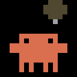
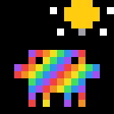
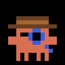
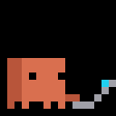
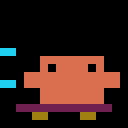
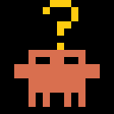
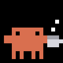
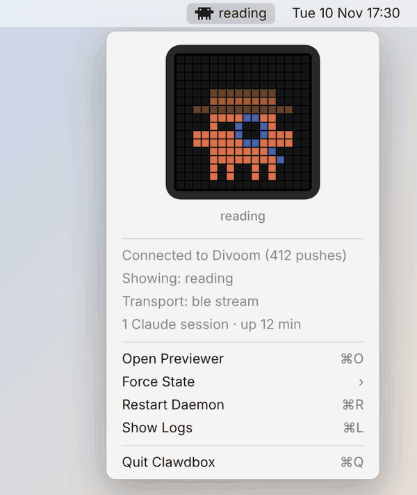

<p align="center">
  
</p>

<h1 align="center">clawdbox</h1>

<p align="center">
  A desk companion for <a href="https://claude.com/claude-code">Claude Code</a>.<br>
  Clawd lives on a 16×16 Divoom LED panel and acts out whatever Claude is doing.
</p>

<p align="center">
  <a href="https://github.com/edmerrett/clawdbox/actions/workflows/ci.yml"></a>
  <a href="https://github.com/edmerrett/clawdbox/actions/workflows/codeql.yml"></a>
  <a href="https://github.com/edmerrett/clawdbox/releases"></a>
  <a href="LICENSE"></a>
</p>

---

Claude reads a file, Clawd puts on a detective hat. Claude edits code, Clawd types on a tiny laptop. Claude runs a
command, Clawd skateboards. Claude needs you, Clawd holds up a question mark. Leave it alone for ten minutes and
Clawd makes a coffee. Say thanks and you get a heart.

## The thirteen states

| | | | |
|:-:|:-:|:-:|:-:|
|  |  |  |  |
| **idle**<br><sub>waiting for you</sub> | **thinking**<br><sub>between tool calls</sub> | **ultrathink**<br><sub>you asked it to</sub> | **reading**<br><sub>Read, Grep, web</sub> |
|  |  |  |  |
| **writing**<br><sub>Edit, Write</sub> | **running**<br><sub>Bash</sub> | **needs-you**<br><sub>permission or a question</sub> | **wave**<br><sub>a new session</sub> |
|  |  |  |  |
| **done**<br><sub>a long turn finished</sub> | **error**<br><sub>a tool failed</sub> | **heart**<br><sub>you said thanks</sub> | **coffee**<br><sub>idle 10 minutes</sub> |
|  | | | |
| **vibing**<br><sub>idle 20 minutes</sub> | | | |

`wave`, `done`, `error` and `heart` are 3.5-second flashes, and with several sessions open the most urgent one
wins. The poses follow Anthropic's [Claude Code stickers](https://www.stickermule.com/uk/claudecode).
[Exactly what triggers each state →](docs/STATES.md)

## Install

You need a Mac, a **Divoom TimeBox Evo** paired in System Settings → Bluetooth, **Node 20+**, **Python 3.10+** and
the Xcode command line tools (`xcode-select --install`). From Terminal.app or iTerm2:

```bash
curl -fsSL https://raw.githubusercontent.com/edmerrett/clawdbox/main/install.sh | bash
```

The installer clones to `~/Tools/clawdbox`, installs the Claude Code hooks and builds `Clawdbox.app` (the menu bar
app, which also runs the daemon). It registers the app to start at login, turns on automatic updates, and waits
for Clawd to appear on the panel. macOS asks once whether Clawdbox may use Bluetooth: allow it. Before you run it:

- Turn off the **Divoom phone app's Bluetooth**, or the app keeps grabbing the box. It takes one controller at a time.
- Have the **original 2018 Evo**? Add `--mac XX:XX:XX:XX:XX:XX` (`| bash -s -- --mac …`). [Which one do I have? →](docs/HARDWARE.md)
- Prefer to read it first? `curl -fsSLO …/install.sh && less install.sh && bash install.sh`. Each release
  publishes a `SHA256SUMS` covering `install.sh`.

`uninstall.sh` removes everything it set up. [Step-by-step install, daemon flags and hooks →](docs/INSTALL.md)

## In the menu bar



A little Clawd sits in the menu bar with the current state beside it:

| Menu bar | Meaning |
|---|---|
| `reading`, `writing`, … | connected; this is what the panel shows |
| `connecting…` (icon pulsing) | reaching the Divoom over Bluetooth, after start-up or a dropped link |
| `no panel` (icon dimmed) | still not connected after 45 s; the menu says why, and it keeps retrying |
| `updating…` | an update is installing; the menu shows its current step |
| `offline` | the daemon is not running (use Restart Daemon) |

Click it and the menu opens on a small **digital Divoom**: the same 16×16 sprites, playing whatever the real panel
shows, live. Below it are the connection, transport, sessions and version, then **Check for Updates…**,
**Open Previewer** (the same view in a browser at <http://127.0.0.1:7676>), **Force State** (hold any of the
thirteen until you release it), **Restart Daemon**, **Show Logs** and, when a release is out, **Install Update…**.

<br clear="right">

## Updates

Releases install themselves. Every six hours a background updater looks for a new signed release. It installs it,
rebuilds what changed and restarts Clawdbox. **Check for Updates…** does the same on demand, shows each step in the
menu, and ends with "Clawdbox updated to x.y.z", "Nothing to install", or the step that failed (the log is
`~/Library/Logs/clawdbox/update.log`).

Only tags signed with the release key in [`scripts/release-signers`](scripts/release-signers) are installed, so
push access to this repository is not enough to ship code to your Mac.

**Leave `~/Tools/clawdbox` to the updater.** Running `git pull` or switching branches in it gets ahead of what is
built and running. To hack on clawdbox, clone it somewhere else ([Contributing](CONTRIBUTING.md)).

## Troubleshooting

- **macOS asks for Bluetooth again after every update.** Clawdbox has no paid Apple signature, so by default each
  rebuild looks like a new app. Run `menubar/make-signing-cert.sh` once (the installer does this for new installs):
  it creates a local signing certificate that keeps the app's identity, and the permission, across updates.
- **"Clawdbox can run in the background" at every login.** Install 0.4.4 or later. If it keeps appearing, earlier
  installs left stale entries: run `sfltool resetbtm` and restart. Keep Clawdbox out of System Settings →
  General → Login Items → *Open at Login*, because its login agent already starts it.
- **Stuck on `connecting…` or `no panel`.** Make sure the box is on and nearby, and that the Divoom phone app is not
  connected to it. Then use **Restart Daemon**. Logs: **Show Logs**.
- **An update seems to do nothing.** Read the last lines of `~/Library/Logs/clawdbox/update.log`. If the menu shows
  a different version than you expect, use **Restart Daemon**.

## How it works

```
Claude Code ──hook──▶ private socket ──▶ clawdbox daemon ──▶ Bluetooth ──▶ Divoom panel
                                         ├─ reducer    which state each session is in
                                         ├─ scheduler  hold ≥2 s, switch on a loop boundary, flashes jump the queue
                                         └─ display    stream Clawd's frames to the LEDs
                     Clawdbox.app ◀── 127.0.0.1:7676 ──┘   (menu bar, previewer; hosts and restarts the daemon)
```

Claude Code's [hooks](https://code.claude.com/docs/en/hooks) fire on every tool call, prompt, permission request
and stop. Each one hands a little JSON to the daemon's private Unix socket in the background and never waits. The
daemon works out what Clawd should be doing for each session, smooths the flicker of rapid tool calls, and streams
the right loop to the panel. It drives the newer Evo over Bluetooth LE through a small Python bridge, and the
original Evo over Bluetooth Classic. Clawdbox.app owns the Bluetooth permission and runs the daemon as its child.

## Make it yours

Every sprite is a few lines of ASCII in [`src/anim/clawd.ts`](src/anim/clawd.ts). Or draw your own in Aseprite or
Piskel and run `clawdbox build-anims`; any state you don't draw falls back to the built-in one.
[Art guide and LED rules →](art/README.md)

## Security

Everything runs locally. Hook events, which include your prompt text, go over a Unix socket only your user can
open, and the daemon never logs or stores them. The HTTP port listens on 127.0.0.1 only and rejects browser
requests from other sites. Nothing runs as root or writes outside your home folder. Updates install only release
tags signed by the release key. The repository requires reviewed, CI-green pull requests on `main` and runs CodeQL
and Dependabot. [Full details →](SECURITY.md)

## More

- [Hardware and protocols](docs/HARDWARE.md): the two Evos, BLE modes, prior art, phone interference
- [States and triggers](docs/STATES.md) · [Install and daemon options](docs/INSTALL.md) · [Art](art/README.md)
- [Contributing](CONTRIBUTING.md) · [Changelog](CHANGELOG.md) · [Security](SECURITY.md)
- The BLE protocol is [divoom-protocol](https://github.com/orionparrott/divoom-protocol)'s work; the Classic protocol follows
  [RomRider](https://github.com/RomRider/node-divoom-timebox-evo) and [hass-divoom](https://github.com/d03n3rfr1tz3/hass-divoom).

## Licence

MIT. Clawd is Anthropic's character, reproduced here for a desk toy; this project is not affiliated with Anthropic or Divoom.
